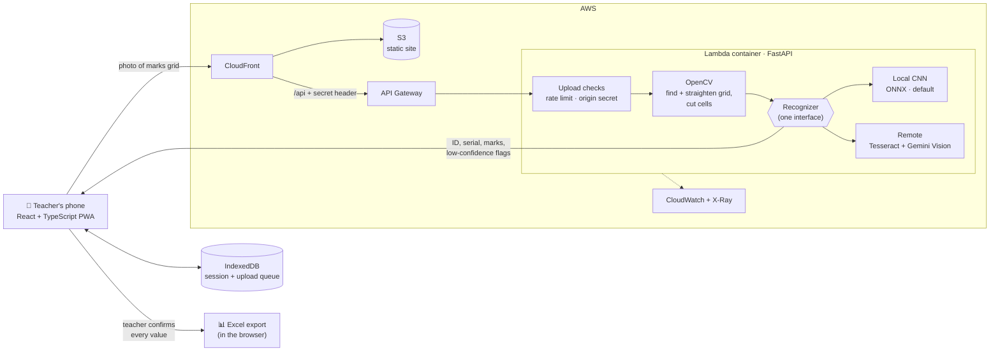

<picture><source media="(prefers-color-scheme: dark)" srcset="assets/header-dark.svg"><source media="(prefers-color-scheme: light)" srcset="assets/header-light.svg"></picture>

<a href="https://mahir-portfolio-five.vercel.app"><picture><source media="(prefers-color-scheme: dark)" srcset="assets/btn-work-dark.svg"><source media="(prefers-color-scheme: light)" srcset="assets/btn-work-light.svg"></picture></a>&nbsp;&nbsp;<a href="assets/Mahir_Al_Kamal_CV.pdf"><picture><source media="(prefers-color-scheme: dark)" srcset="assets/btn-cv-dark.svg"><source media="(prefers-color-scheme: light)" srcset="assets/btn-cv-light.svg"></picture></a>

<a href="https://linkedin.com/in/mahiralkamal"><picture><source media="(prefers-color-scheme: dark)" srcset="assets/pill-linkedin-dark.svg"><source media="(prefers-color-scheme: light)" srcset="assets/pill-linkedin-light.svg"></picture></a>&nbsp;<a href="mailto:mahiralkamal.mak@gmail.com"><picture><source media="(prefers-color-scheme: dark)" srcset="assets/pill-email-dark.svg"><source media="(prefers-color-scheme: light)" srcset="assets/pill-email-light.svg"></picture></a>&nbsp;<a href="https://mahir-portfolio-five.vercel.app"><picture><source media="(prefers-color-scheme: dark)" srcset="assets/pill-portfolio-dark.svg"><source media="(prefers-color-scheme: light)" srcset="assets/pill-portfolio-light.svg"></picture></a>

 

<picture><source media="(prefers-color-scheme: dark)" srcset="assets/sec-01-dark.svg"><source media="(prefers-color-scheme: light)" srcset="assets/sec-01-light.svg"></picture>

<table>
<tr>
<td width="50%" valign="top">

`HIGHLIGHTS`

- Almost 4 years building React and Node.js apps for government and enterprise clients
- Worked on national platforms for the **Bangladesh Election Commission** and the **Anti-Corruption Commission**
- Built an AI grading tool with a model I trained, piloted in a live class
- Mentored two interns who were later hired full-time

</td>
<td width="50%" valign="top">

`RIGHT NOW`

- Looking for a full-time Software Engineer role
- MSc in Computer Science at IUB, expected 2027
- Researching how LLMs pick ML algorithms for medical datasets
- Teaching the Algorithms and Data Structures labs
- Working spec-first with Claude Code

</td>
</tr>
</table>

 

<picture><source media="(prefers-color-scheme: dark)" srcset="assets/sec-02-dark.svg"><source media="(prefers-color-scheme: light)" srcset="assets/sec-02-light.svg"></picture>

<table>
<tr>
<td width="32%" valign="top">

**Penta Global Limited** 
Software Engineer 
`OCT 2023 – PRESENT`

</td>
<td valign="top">

- **Neustring** · B2B telecom roaming analytics for a US client. Tables, charts and exports that stay fast on large datasets, plus Amazon QuickSight dashboards
- **Election Management & Online Nomination System** · Bangladesh Election Commission. Step-by-step nomination forms and role-based screens, with every action traceable for audit
- **ACC ERP** · Anti-Corruption Commission. Role-gated modules and long multi-step forms with drafts that save
- Moved legacy Jinja and jQuery screens to React without stopping feature work

`REACT / TYPESCRIPT / REDUX TOOLKIT / RTK QUERY / AMAZON QUICKSIGHT`

</td>
</tr>
<tr>
<td valign="top">

**Independent University, Bangladesh** 
Adjunct Faculty & Research Assistant 
Part-Time Frontend Developer 
`DEC 2022 – PRESENT`

</td>
<td valign="top">

- Teach the Algorithms and Data Structures labs in Python, with browser-based algorithm visualizers I built for them
- Research: *LLM-Based Algorithm Selection for Tabular Medical Datasets* (manuscript in preparation)
- Worked on the frontend of IUB's public website

</td>
</tr>
</table>

 

<picture><source media="(prefers-color-scheme: dark)" srcset="assets/sec-03-dark.svg"><source media="(prefers-color-scheme: light)" srcset="assets/sec-03-light.svg"></picture>

<table>
<tr>
<td width="36%" valign="top" align="center">

</td>
<td valign="top">

### Exam Script Mark Scanner

I was copying marks off paper exam scripts into Excel by hand every exam. Now I photograph the cover page, check every value, and the marks land in the spreadsheet. Piloted in a live university class.

- OpenCV finds and straightens the marks grid, then cuts it into cells
- A local CNN, or Tesseract with a Gemini Vision fallback, behind one interface
- The CNN I trained in PyTorch reads **91.8%** of handwritten ID digits correctly, against **44.5%** for Tesseract
- Hosted on AWS with rate limiting and an origin guard · 259 pytest and 383 Vitest tests

`PYTHON / FASTAPI / OPENCV / PYTORCH / ONNX / GEMINI API / REACT / TYPESCRIPT / AWS LAMBDA`

[**Live demo ↗**](https://d2n2meq17rr1oi.cloudfront.net) &nbsp;·&nbsp; [Code ↗](https://github.com/iammahir2020/marks-upload)

</td>
</tr>
</table>

<code>HOW IT WORKS</code> &nbsp;architecture diagram

 

The recognizer is picked once at startup, so the pipeline never cares which one is running. The local CNN became the default after it beat Tesseract on real class photos, and it needs no network and has no rate limit to hit mid-class.

 

### Battle of Polashi

An unofficial online version of Polashi, Playground Inc.'s hidden-role board game, built so our group could play from their own phones. The server enforces every rule, so a player with devtools open can't cheat, and each player only receives their own view, so hidden roles never leak.

- Every Socket.IO event validated with zod; reconnect tokens put players back in their own seat after a refresh
- Audited it as an attacker and closed what I found: rate limits per socket and per IP, origin checks, message caps
- Moved from Firestore to PostgreSQL with versioned migrations, without breaking play; live rooms survive a deploy
- ~70 backend and ~240 frontend tests, plus Playwright runs of a full 5-player game

`NODE.JS / EXPRESS 5 / SOCKET.IO / POSTGRESQL / ZOD / REACT 19 / TYPESCRIPT / PLAYWRIGHT`

[**Play it live ↗**](https://the-great-polashi-game.vercel.app) &nbsp;·&nbsp; [Backend ↗](https://github.com/iammahir2020/polashi_game_backend) &nbsp;·&nbsp; [Frontend ↗](https://github.com/iammahir2020/polashi_game_frontend)

 

<table>
<tr>
<td width="50%" valign="top">

### DSE Market Monitor

Watching Dhaka Stock Exchange prices meant refreshing a page and hoping to catch the move. Investors set price, percentage or volume alerts, the service checks them every two minutes, and the alert lands on a live dashboard and on Telegram.

- Cooldowns and de-duplication so nobody gets spammed
- Phone OTP login, JWT sessions, authenticated WebSockets
- Telegram bot linked by one-time deep links

`NODE.JS / EXPRESS / MONGODB / WEBSOCKETS / TELEGRAM BOT API / REACT`

[**Live ↗**](https://dse-monitor-frontend.vercel.app) &nbsp;·&nbsp; [Backend ↗](https://github.com/iammahir2020/dse-monitor-backend) &nbsp;·&nbsp; [Frontend ↗](https://github.com/iammahir2020/dse-monitor-frontend)

</td>
<td width="50%" valign="top">

### Event-Driven BFF on AWS

I wanted AWS experience that went past tutorials, so I built the same backend-for-frontend pattern twice: GraphQL subscriptions in CDK, and REST plus WebSockets in SAM.

- DynamoDB Streams → AppSync, pushing every write to open browsers
- EventBridge → SQS (with a dead-letter queue) → Lambda
- Cognito auth, plus a custom Lambda JWT authorizer

`AWS CDK / SAM / LAMBDA / DYNAMODB / APPSYNC / EVENTBRIDGE / SQS / COGNITO`

[CDK build ↗](https://github.com/iammahir2020/bff-practice) &nbsp;·&nbsp; [SAM build ↗](https://github.com/iammahir2020/aws-bff-price-alert)

</td>
</tr>
</table>

<code>MORE</code> &nbsp;ZipGrip Tooling, e-commerce with Stripe payments

 

A storefront from cart to checkout, with Stripe handling the payment step so card data never touches the app's own servers. JWT auth and role-based access on the server separate the customer and admin views.

`REACT / NODE.JS / EXPRESS / MONGODB / STRIPE`

[**Live ↗**](https://zipgrip-tooling.web.app/) &nbsp;·&nbsp; [Client ↗](https://github.com/iammahir2020/zipGrip-tooling-client) &nbsp;·&nbsp; [Server ↗](https://github.com/iammahir2020/zipGrip-tooling-server)

 

<picture><source media="(prefers-color-scheme: dark)" srcset="assets/sec-04-dark.svg"><source media="(prefers-color-scheme: light)" srcset="assets/sec-04-light.svg"></picture>

| | |
|---|---|
| `FRONTEND` |  |
| `BACKEND` |  |
| `DATA` |  |
| `AI` |  &nbsp;Gemini API · ONNX · RAG (research) |
| `CLOUD & TOOLS` |  |

 

<picture><source media="(prefers-color-scheme: dark)" srcset="assets/sec-05-dark.svg"><source media="(prefers-color-scheme: light)" srcset="assets/sec-05-light.svg"></picture>

`AGENTIC WORKFLOWS & MCP` &nbsp; `LANGCHAIN / RAG` &nbsp; `NESTJS` &nbsp; `NEXT.JS CACHING` &nbsp; `SYSTEM DESIGN`

 

  

 

<picture><source media="(prefers-color-scheme: dark)" srcset="assets/sec-06-dark.svg"><source media="(prefers-color-scheme: light)" srcset="assets/sec-06-light.svg"></picture>

<a href="https://mahir-portfolio-five.vercel.app"><picture><source media="(prefers-color-scheme: dark)" srcset="assets/btn-work-dark.svg"><source media="(prefers-color-scheme: light)" srcset="assets/btn-work-light.svg"></picture></a>&nbsp;&nbsp;<a href="assets/Mahir_Al_Kamal_CV.pdf"><picture><source media="(prefers-color-scheme: dark)" srcset="assets/btn-cv-dark.svg"><source media="(prefers-color-scheme: light)" srcset="assets/btn-cv-light.svg"></picture></a>

`MAHIRALKAMAL.MAK@GMAIL.COM` &nbsp;·&nbsp; `DHAKA, BANGLADESH`

