

<picture><source media="(prefers-color-scheme: dark)" srcset="assets/header-dark.svg"><source media="(prefers-color-scheme: light)" srcset="assets/header-light.svg">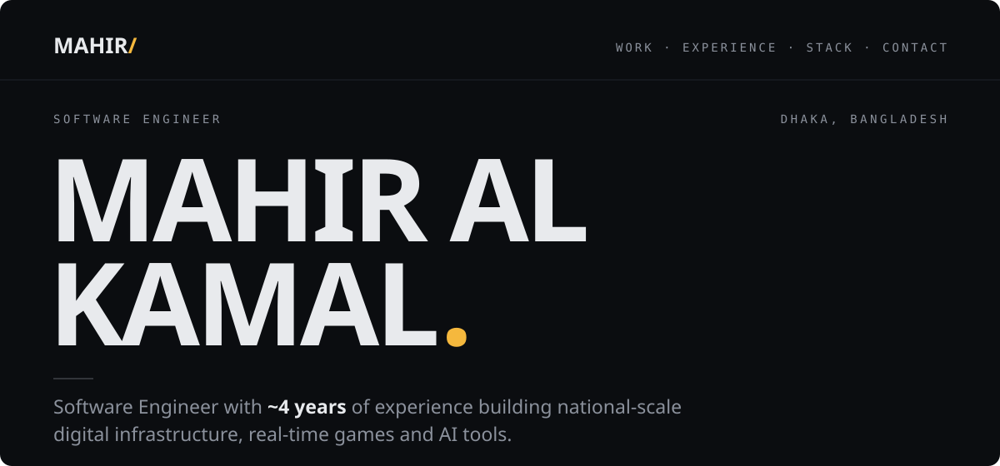</picture>

<a href="https://mahir-portfolio-five.vercel.app"><picture><source media="(prefers-color-scheme: dark)" srcset="assets/btn-work-dark.svg"><source media="(prefers-color-scheme: light)" srcset="assets/btn-work-light.svg"></picture></a>&nbsp;&nbsp;<a href="assets/Mahir_Al_Kamal_CV.pdf"><picture><source media="(prefers-color-scheme: dark)" srcset="assets/btn-cv-dark.svg"><source media="(prefers-color-scheme: light)" srcset="assets/btn-cv-light.svg"></picture></a>

<a href="https://linkedin.com/in/mahiralkamal"><picture><source media="(prefers-color-scheme: dark)" srcset="assets/pill-linkedin-dark.svg"><source media="(prefers-color-scheme: light)" srcset="assets/pill-linkedin-light.svg"></picture></a>&nbsp;<a href="mailto:mahiralkamal.mak@gmail.com"><picture><source media="(prefers-color-scheme: dark)" srcset="assets/pill-email-dark.svg"><source media="(prefers-color-scheme: light)" srcset="assets/pill-email-light.svg"></picture></a>&nbsp;<a href="https://mahir-portfolio-five.vercel.app"><picture><source media="(prefers-color-scheme: dark)" srcset="assets/pill-portfolio-dark.svg"><source media="(prefers-color-scheme: light)" srcset="assets/pill-portfolio-light.svg"></picture></a>

 

<picture><source media="(prefers-color-scheme: dark)" srcset="assets/sec-01-dark.svg"><source media="(prefers-color-scheme: light)" srcset="assets/sec-01-light.svg"></picture>

<picture><source media="(prefers-color-scheme: dark)" srcset="assets/about-dark.svg"><source media="(prefers-color-scheme: light)" srcset="assets/about-light.svg"></picture>

 

<picture><source media="(prefers-color-scheme: dark)" srcset="assets/sec-02-dark.svg"><source media="(prefers-color-scheme: light)" srcset="assets/sec-02-light.svg"></picture>

<picture><source media="(prefers-color-scheme: dark)" srcset="assets/experience-dark.svg"><source media="(prefers-color-scheme: light)" srcset="assets/experience-light.svg"></picture>

 

<picture><source media="(prefers-color-scheme: dark)" srcset="assets/sec-03-dark.svg"><source media="(prefers-color-scheme: light)" srcset="assets/sec-03-light.svg"></picture>


<table>
<tr>
<td width="32%" valign="top" align="center">
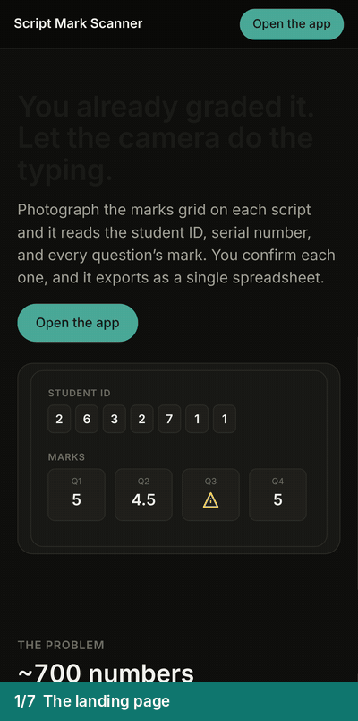
</td>
<td valign="top">

<picture><source media="(prefers-color-scheme: dark)" srcset="assets/scanner-detail-dark.svg"><source media="(prefers-color-scheme: light)" srcset="assets/scanner-detail-light.svg"></picture>

</td>
</tr>
</table>

<a href="https://d2n2meq17rr1oi.cloudfront.net"><picture><source media="(prefers-color-scheme: dark)" srcset="assets/link-live-demo-dark.svg"><source media="(prefers-color-scheme: light)" srcset="assets/link-live-demo-light.svg"></picture></a>&nbsp;<a href="https://github.com/iammahir2020/marks-upload"><picture><source media="(prefers-color-scheme: dark)" srcset="assets/link-code-dark.svg"><source media="(prefers-color-scheme: light)" srcset="assets/link-code-light.svg"></picture></a>

<code>HOW IT WORKS</code> &nbsp;architecture diagram

 

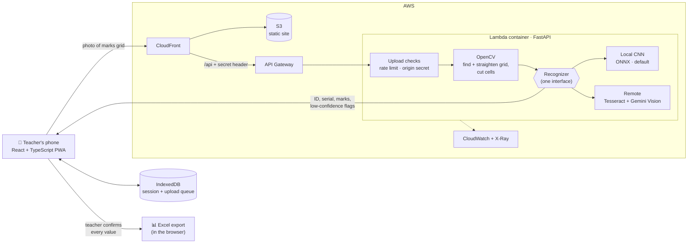

The recognizer is picked once at startup, so the pipeline never cares which one is running. The local CNN became the default after it beat Tesseract on real class photos, and it needs no network and has no rate limit to hit mid-class.

 


<picture><source media="(prefers-color-scheme: dark)" srcset="assets/polashi-detail-dark.svg"><source media="(prefers-color-scheme: light)" srcset="assets/polashi-detail-light.svg"></picture>

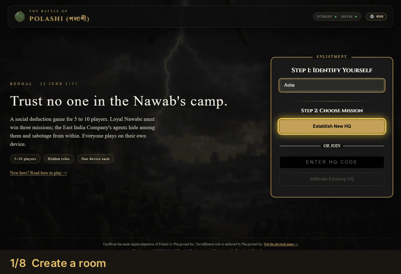

<a href="https://the-great-polashi-game.vercel.app"><picture><source media="(prefers-color-scheme: dark)" srcset="assets/link-play-live-dark.svg"><source media="(prefers-color-scheme: light)" srcset="assets/link-play-live-light.svg"></picture></a>&nbsp;<a href="https://github.com/iammahir2020/polashi_game_backend"><picture><source media="(prefers-color-scheme: dark)" srcset="assets/link-backend-dark.svg"><source media="(prefers-color-scheme: light)" srcset="assets/link-backend-light.svg"></picture></a>&nbsp;<a href="https://github.com/iammahir2020/polashi_game_frontend"><picture><source media="(prefers-color-scheme: dark)" srcset="assets/link-frontend-dark.svg"><source media="(prefers-color-scheme: light)" srcset="assets/link-frontend-light.svg"></picture></a>

 

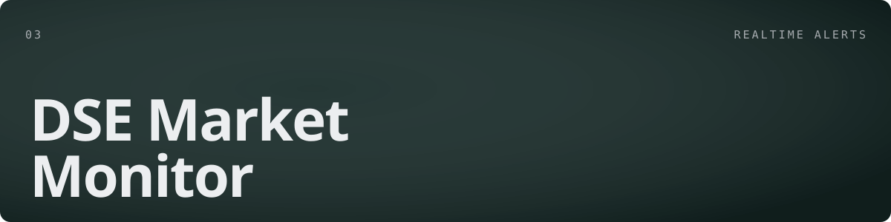

<picture><source media="(prefers-color-scheme: dark)" srcset="assets/dse-detail-dark.svg"><source media="(prefers-color-scheme: light)" srcset="assets/dse-detail-light.svg"></picture>

<a href="https://dse-monitor-frontend.vercel.app"><picture><source media="(prefers-color-scheme: dark)" srcset="assets/link-live-dark.svg"><source media="(prefers-color-scheme: light)" srcset="assets/link-live-light.svg"></picture></a>&nbsp;<a href="https://github.com/iammahir2020/dse-monitor-backend"><picture><source media="(prefers-color-scheme: dark)" srcset="assets/link-backend-dark.svg"><source media="(prefers-color-scheme: light)" srcset="assets/link-backend-light.svg"></picture></a>&nbsp;<a href="https://github.com/iammahir2020/dse-monitor-frontend"><picture><source media="(prefers-color-scheme: dark)" srcset="assets/link-frontend-dark.svg"><source media="(prefers-color-scheme: light)" srcset="assets/link-frontend-light.svg"></picture></a>

 

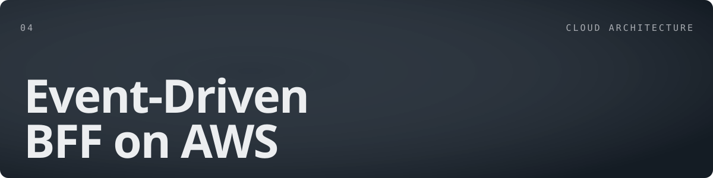

<picture><source media="(prefers-color-scheme: dark)" srcset="assets/aws-detail-dark.svg"><source media="(prefers-color-scheme: light)" srcset="assets/aws-detail-light.svg"></picture>

<a href="https://github.com/iammahir2020/bff-practice"><picture><source media="(prefers-color-scheme: dark)" srcset="assets/link-cdk-dark.svg"><source media="(prefers-color-scheme: light)" srcset="assets/link-cdk-light.svg"></picture></a>&nbsp;<a href="https://github.com/iammahir2020/aws-bff-price-alert"><picture><source media="(prefers-color-scheme: dark)" srcset="assets/link-sam-dark.svg"><source media="(prefers-color-scheme: light)" srcset="assets/link-sam-light.svg"></picture></a>

<code>MORE</code> &nbsp;ZipGrip Tooling, e-commerce with Stripe payments

 

<picture><source media="(prefers-color-scheme: dark)" srcset="assets/zipgrip-detail-dark.svg"><source media="(prefers-color-scheme: light)" srcset="assets/zipgrip-detail-light.svg"></picture>

<a href="https://zipgrip-tooling.web.app/"><picture><source media="(prefers-color-scheme: dark)" srcset="assets/link-live-dark.svg"><source media="(prefers-color-scheme: light)" srcset="assets/link-live-light.svg"></picture></a>&nbsp;<a href="https://github.com/iammahir2020/zipGrip-tooling-client"><picture><source media="(prefers-color-scheme: dark)" srcset="assets/link-client-dark.svg"><source media="(prefers-color-scheme: light)" srcset="assets/link-client-light.svg"></picture></a>&nbsp;<a href="https://github.com/iammahir2020/zipGrip-tooling-server"><picture><source media="(prefers-color-scheme: dark)" srcset="assets/link-server-dark.svg"><source media="(prefers-color-scheme: light)" srcset="assets/link-server-light.svg"></picture></a>

 

<picture><source media="(prefers-color-scheme: dark)" srcset="assets/sec-04-dark.svg"><source media="(prefers-color-scheme: light)" srcset="assets/sec-04-light.svg">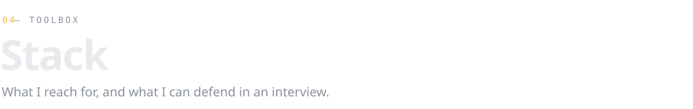</picture>

<picture><source media="(prefers-color-scheme: dark)" srcset="assets/stack-dark.svg"><source media="(prefers-color-scheme: light)" srcset="assets/stack-light.svg"></picture>

 

<picture><source media="(prefers-color-scheme: dark)" srcset="assets/sec-05-dark.svg"><source media="(prefers-color-scheme: light)" srcset="assets/sec-05-light.svg"></picture>

<picture><source media="(prefers-color-scheme: dark)" srcset="assets/exploring-dark.svg"><source media="(prefers-color-scheme: light)" srcset="assets/exploring-light.svg"></picture>

 

<picture><source media="(prefers-color-scheme: dark)" srcset="https://raw.githubusercontent.com/iammahir2020/iammahir2020/output/activity-dark.svg"><source media="(prefers-color-scheme: light)" srcset="https://raw.githubusercontent.com/iammahir2020/iammahir2020/output/activity-light.svg"></picture>

 

<picture><source media="(prefers-color-scheme: dark)" srcset="assets/sec-06-dark.svg"><source media="(prefers-color-scheme: light)" srcset="assets/sec-06-light.svg"></picture>

<a href="https://mahir-portfolio-five.vercel.app"><picture><source media="(prefers-color-scheme: dark)" srcset="assets/btn-work-dark.svg"><source media="(prefers-color-scheme: light)" srcset="assets/btn-work-light.svg"></picture></a>&nbsp;&nbsp;<a href="assets/Mahir_Al_Kamal_CV.pdf"><picture><source media="(prefers-color-scheme: dark)" srcset="assets/btn-cv-dark.svg"><source media="(prefers-color-scheme: light)" srcset="assets/btn-cv-light.svg"></picture></a>

`MAHIRALKAMAL.MAK@GMAIL.COM` &nbsp;·&nbsp; `DHAKA, BANGLADESH`

