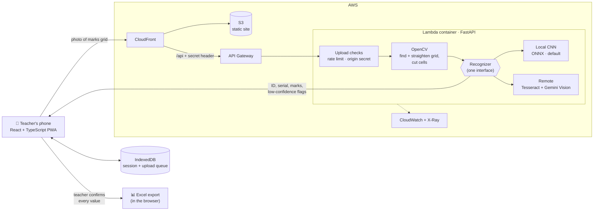

<p align="center">
  
</p>

<p align="center">
  
</p>

<h2 align="center">💻 Software Engineer</h2>
<p align="center">
  ⚡ React • Next.js • Node.js • TypeScript • Python • PostgreSQL • AWS
</p>
<p align="center">
  🟢 Open to full-time Software Engineer roles
</p>

---

## 🧠 Who Am I

```js
const mahir = {
  role: "Software Engineer",
  base: "Dhaka, Bangladesh",
  experience: "Almost 4 years building React and Node.js apps",
  work: "Government & enterprise platforms at Penta Global",
  builds: ["Real-time apps", "AI-in-the-loop tools", "Event-driven backends"],
  alsoDoing: "MSc in CS at IUB, researching how LLMs pick ML algorithms",
  teaching: "Algorithms & Data Structures labs at IUB",
  workflow: "Spec-driven development with Claude Code"
};
```

---

## ✨ Highlights

* 🏛️ Worked on national platforms for the **Bangladesh Election Commission** and the **Anti-Corruption Commission**
* 🤖 Built an AI grading tool with a model I trained, served from FastAPI and piloted in a live class
* 🔄 Moved legacy Jinja and jQuery screens to React one screen at a time, without stopping feature work
* 🧑‍🏫 Mentored two interns who were later hired full-time

---

## 🏢 Work

**Penta Global Limited, Dhaka** · Software Engineer · Oct 2023 – Present

* **Neustring:** B2B telecom roaming analytics for a US client. Tables, charts and filtered exports on large datasets, kept fast with server-side pagination and memoized selectors, plus Amazon QuickSight dashboards
* **Election Management & Online Nomination System:** step-by-step nomination forms that stop a filing from moving forward while its data is incomplete, and role-based screens where every action is traceable for audit
* **ACC ERP:** role-gated modules and long multi-step forms with drafts that save, so nobody loses half a form

**Independent University, Bangladesh** · Adjunct Faculty & Research Assistant · Part-Time Frontend Developer

* Teach the Algorithms and Data Structures labs in Python
* Research: *LLM-Based Algorithm Selection for Tabular Medical Datasets* (manuscript in preparation)

---

## 🛠️ Tech Arsenal

<p align="center">
  
</p>

---

## 🚀 Featured Work

### 🧾 [Exam Script Mark Scanner](https://github.com/iammahir2020/marks-upload)
Faculty photograph exam script cover pages, and the app reads student IDs and marks and exports the session to Excel. Piloted in a live university class. Detection fails loudly rather than risk a wrong mark, and the teacher confirms every value before it's saved.

🌐 **[Live demo](https://d2n2meq17rr1oi.cloudfront.net)**

<p align="center">
  
</p>

<details>
<summary><b>How it works</b> (architecture)</summary>



The recognizer is picked once at startup, so the pipeline never cares which one is running. The local CNN became the default after it beat Tesseract on real class photos, and it needs no network and has no rate limit to hit mid-class.

</details>

```diff
+ OpenCV grid detection and deskew, with a local CNN or Tesseract and a Gemini Vision fallback behind one interface
+ Trained the CNN in PyTorch: 91.8% of handwritten ID digits read correctly vs 44.5% for Tesseract
+ Hosted on AWS with upload checks, rate limiting and an origin guard
+ 259 pytest and 383 Vitest tests
```
⚙️ Python • FastAPI • OpenCV • PyTorch • Gemini API • React • TypeScript • Docker • AWS Lambda

### 🧠 Battle of Polashi: Real-time Multiplayer Board Game
An unofficial online version of Polashi, a hidden-role social deduction board game by Playground Inc., built so our group could play from their own phones. The server owns every rule, and each player only receives their own view of the game, so hidden roles never leak.

🌐 **[Play it live](https://the-great-polashi-game.vercel.app)**

<p align="center">
  
</p>

```diff
+ Every Socket.IO event validated with zod; per-seat reconnect tokens put players back in their seat after a refresh
+ Audited it as an attacker and closed what I found: rate limits per socket and per IP, origin checks, message size caps
+ Moved from Firestore to PostgreSQL with check constraints and versioned migrations; live rooms survive a deploy
+ ~70 backend and ~240 frontend tests, plus Playwright runs of a full 5-player game
```
⚙️ Node.js • Express 5 • Socket.IO • PostgreSQL (Supabase) • React 19 • TypeScript • Vite • Playwright
🔗 [Backend](https://github.com/iammahir2020/polashi_game_backend) · [Frontend](https://github.com/iammahir2020/polashi_game_frontend)

### 📈 DSE Market Monitor
Stock alerts for the Dhaka Stock Exchange. Investors set price, percentage or volume alerts, and the service checks them every two minutes and notifies users on a live dashboard and on Telegram.
```diff
+ Per-alert cooldowns and de-duplication so users aren't spammed
+ Phone OTP login with hashed, expiring codes, JWT sessions and authenticated WebSockets
+ Telegram bot linked by one-time deep links, with a secret-verified webhook
```
⚙️ Node.js • Express • MongoDB • WebSockets • Telegram Bot API • React • TypeScript • Recharts
🔗 [Backend](https://github.com/iammahir2020/dse-monitor-backend) · [Frontend](https://github.com/iammahir2020/dse-monitor-frontend)

### ☁️ Event-Driven Backend-for-Frontend on AWS
Two hands-on BFF builds of the same pattern from different angles: one GraphQL-subscription based, one REST plus WebSocket.
```diff
+ DynamoDB Streams → AppSync GraphQL subscriptions, pushing every write to open browsers
+ EventBridge → SQS (with a dead-letter queue) → Lambda write path
+ Cognito-protected REST, and a custom Lambda JWT authorizer for the WebSocket version
```
⚙️ AWS CDK • SAM • Lambda • DynamoDB • AppSync • API Gateway • EventBridge • SQS • Cognito
🔗 [CDK build](https://github.com/iammahir2020/bff-practice) · [SAM build](https://github.com/iammahir2020/aws-bff-price-alert)

### 🛒 ZipGrip: E-commerce with Payments
A storefront from cart to checkout, with Stripe handling the payment step so card data never touches the app's own servers.
```diff
+ JWT auth and role-based access separating customer and admin views
```
⚙️ React • Node.js • Express • MongoDB • Stripe

---

## 📚 Currently Exploring

`Agentic workflows & MCP` · `LangChain / RAG` · `NestJS` · `Next.js caching` · `System design`

---

## 🐍 Contribution Graph

<p align="center">
  
</p>

---

## 🌐 Connect

<p align="center">
  <a href="https://linkedin.com/in/mahiralkamal">
    
  </a>
  <a href="mailto:mahiralkamal.mak@gmail.com">
    
  </a>
  <a href="https://mahir-portfolio-five.vercel.app">
    
  </a>
</p>

<p align="center">
  
</p>
